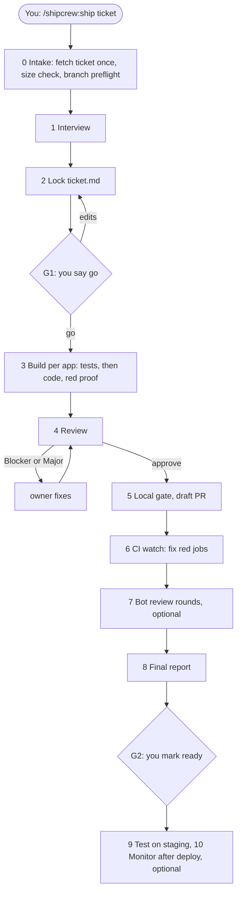

# Workflow

How a ticket becomes a merged change, who does what, and what the scripts enforce. The skills are the source of truth; if this page disagrees with `skills/ship/SKILL.md`, the skill wins.

## In one paragraph

You give the captain a ticket. It reads it once, then interviews you until the problem, outcome and acceptance criteria are clear, and writes `ticket.md`, which you approve. From then on the crew works without you: implementers write failing tests and then code, the reviewer checks the diff against the ticket, the local gate runs the same checks as CI, a draft PR opens and CI is watched until green. You get a report with a risk tier and evidence, and you decide when the PR is ready.

## Where things run

- **One task = one worktree = one branch = one captain.** The worktree sits outside your main checkout, which is never touched. `/shipcrew:spawn` creates it.
- **Subagents are in-session.** Implementers, reviewer and helpers are subagents of the captain, so one conversation supervises a run.
- **State is in files.** `.shipcrew/plans/<change>/` holds the ticket, specs, reports and `progress.md`. Any conversation can pick the run up with `/shipcrew:ship resume <change>`.

## Flow

## Phases

| # | Phase | Who | Output | Done when |
|---|---|---|---|---|
| 0 | Intake | Captain | `ticket-source.md`, `change` name | Ticket fetched, branch valid, tree clean |
| 1 | Interview | Captain + you | Settled decisions | Every branch of the decision tree is closed, or 15 questions reached |
| 2 | Lock | Captain | `ticket.md` | **G1:** you say `go` |
| 3 | Build | Implementers | Tests, code, one commit per app, red-proof files | Tests green, app checks pass, each test fails without the change |
| 4 | Review | Reviewer | Report with verdict | `approve` within 3 loops |
| 5 | Gate and PR | Owner | Draft PR | Gate marker for the pushed commit, PR title valid |
| 6 | CI | Deckhand + owner | Green CI | All required jobs green |
| 7 | Bot rounds | Captain + owner | Pushed fixes | Configured number of rounds done |
| 8 | Final report | Captain | Report | **G2:** you mark ready |
| 9-10 | Staging test, monitor | Tester, monitor | Verdicts | You decide on `watch` or `bad` |

## When you are involved

The interview, G1, any sensitive-data snippet you are asked to run (aggregates only), an escalation after 3 failed retries, picking which review items to apply, G2, removing the worktree after merge, and deciding on a `watch` or `bad` verdict.

## Defaults (no questions asked)

Push when CI is green · resolve the review threads you fixed · post no replies · no bot re-review on fix rounds. Your words change them: `reply`, `no push`, `no commit` (review-only: change and check, stop before commit and push).

## Fix runs

`/shipcrew:ship fix <pr>` works on an existing PR from its triaged comments. It uses the PR's own head branch, only interviews what is still open, and follows the same gate, push, CI and thread-resolving rules. No new PR.

## What the scripts enforce

| Rule | Enforced by |
|---|---|
| Branch is `<type>/<kebab>`, no `-<digit>` suffix | pre-push hook, rename guard |
| A branch with an open PR or a remote copy is never renamed | PreToolUse guard |
| Changes in a configured app need a passing gate for that exact commit | pre-push hook (marker written by `gate.sh`) |
| No co-author or "generated with" lines in commits and PR bodies | commit-msg hook, PreToolUse guard |
| PR title is `<type>: 
` with the ticket id as a suffix | PreToolUse guard |
| Protected paths ask before an edit | PreToolUse guard |

Everything else (red proof, review discipline, interview, rollback, risk tier, sensitive-data and untrusted-input rules) is instruction-level: written in the skills and agents, checked by the reviewer, and promoted to a script when it becomes checkable.

## Safety rails in the process

- Retry cap 3 per failing step or review loop, then you decide.
- Size limit: over about 600 changed lines or 20 files is split into stacked PRs unless you say otherwise at G1.
- No UI work without a design.
- Nothing is pushed with an open Blocker; nothing is called done before CI is green.
